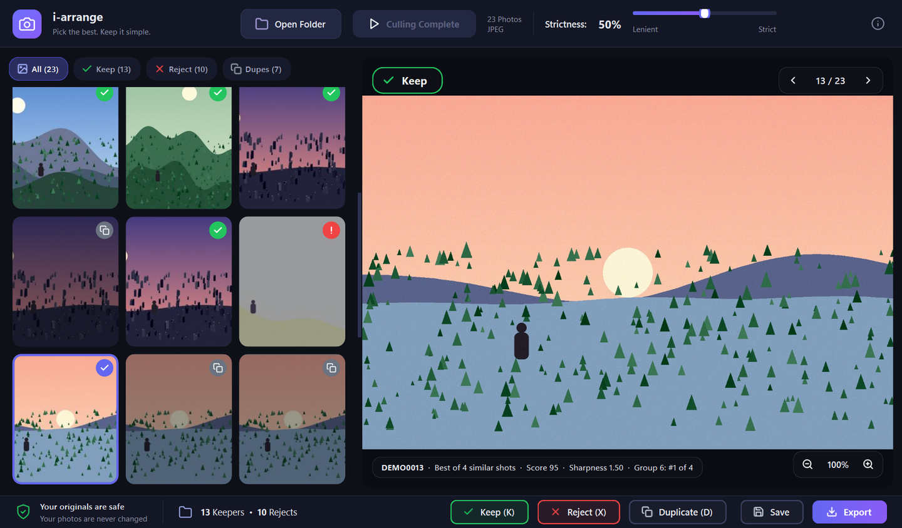
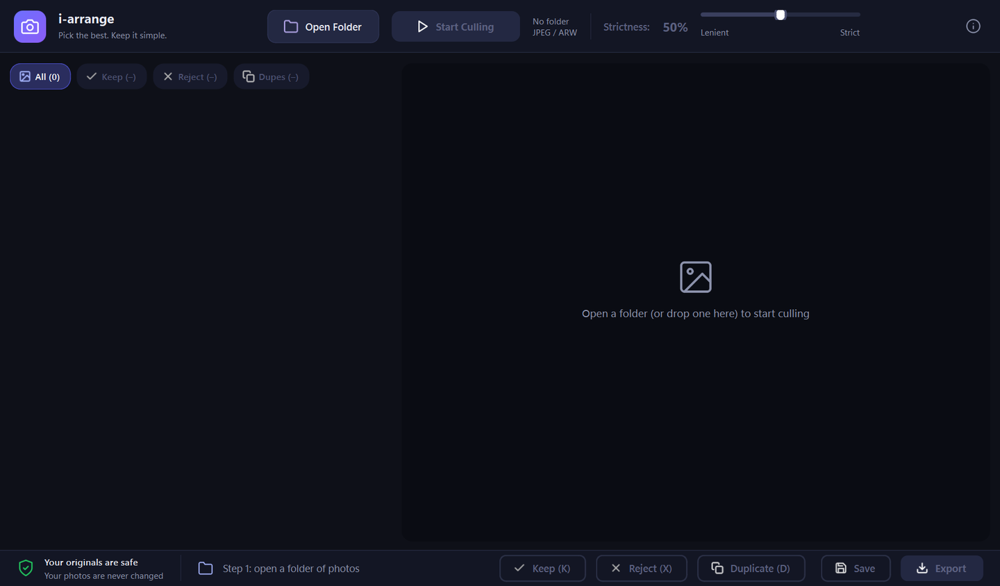
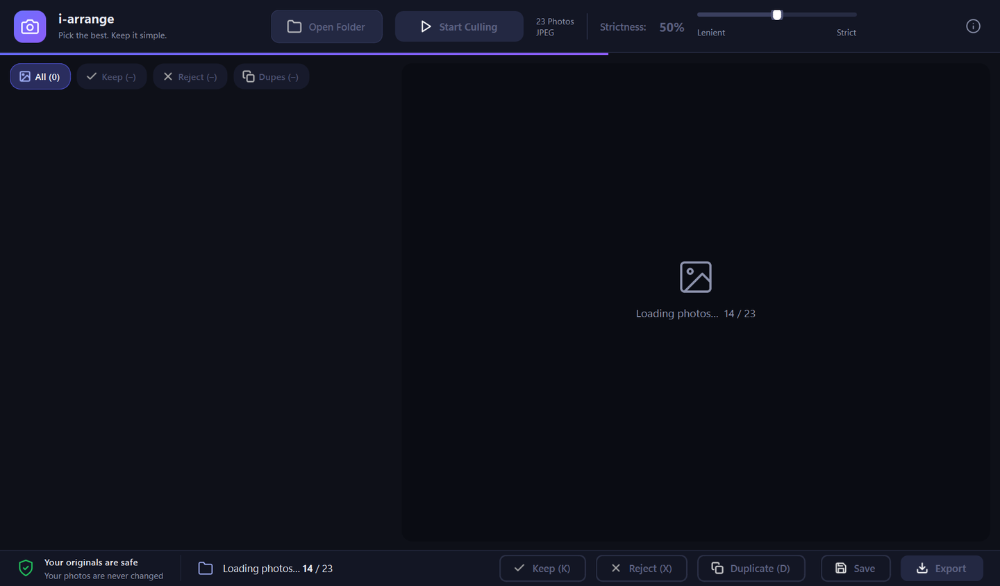
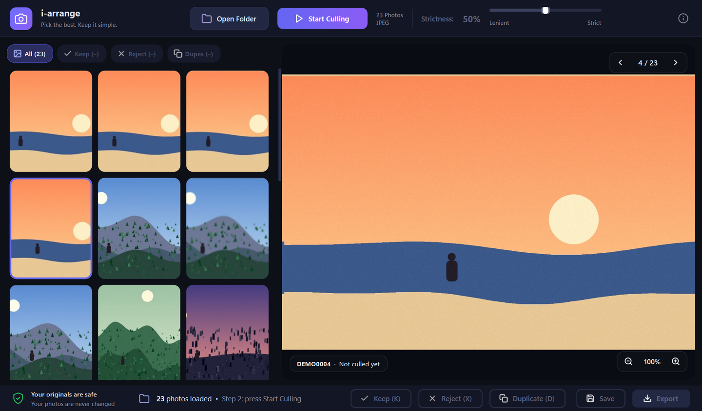
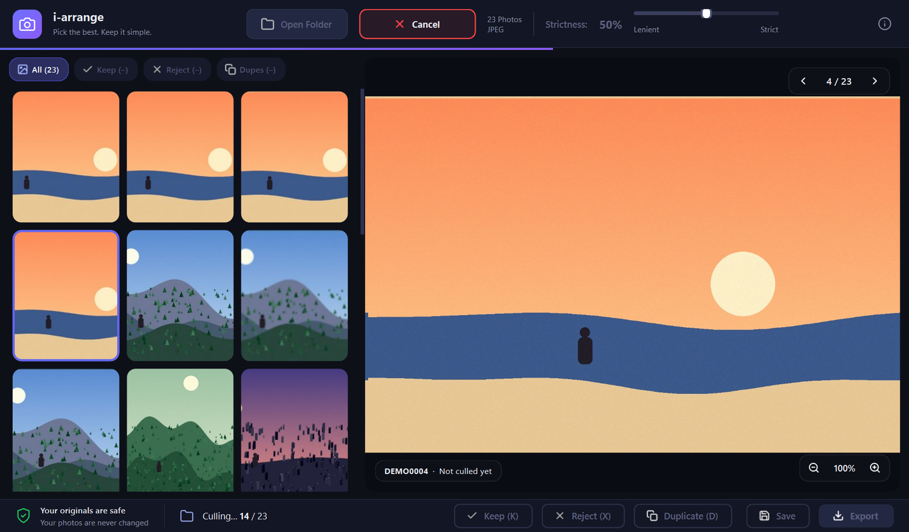
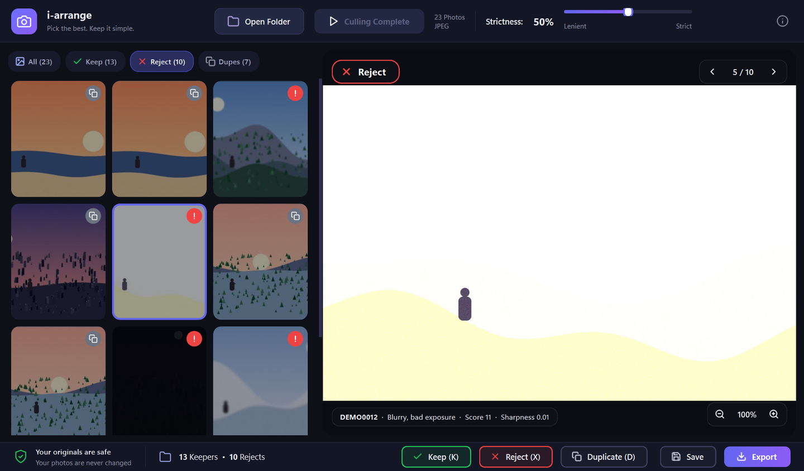
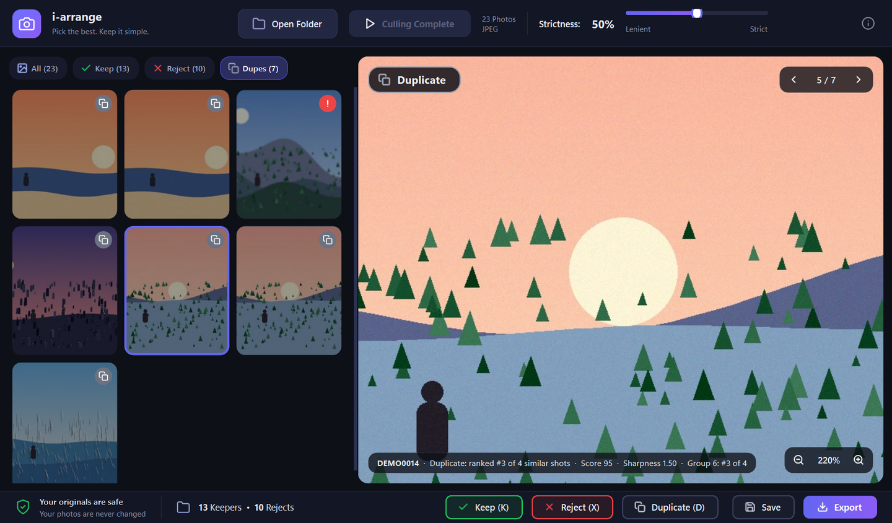
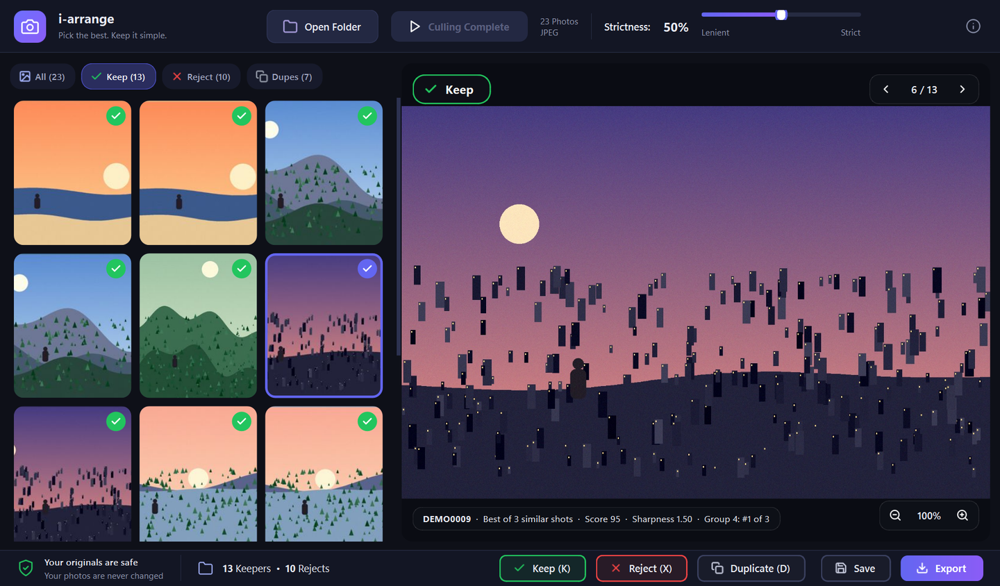

# i-arrange

**Pick the best. Keep it simple.**

i-arrange is a Windows desktop app that does the first pass of culling after a photo shoot. Point it at a folder of
JPEG or Sony ARW photos and it flags the blurry, badly exposed and near-duplicate shots, keeps the best frame of every
burst, and lets you review and override every decision before you save or export. It runs entirely on your own
computer and never changes your original photos.



> The screenshots in this README use synthetic demo photos generated by [`tools/make_demo_photos.py`](tools/make_demo_photos.py),
> not real photos.

## Contents

- [Features](#features)
- [Screenshots](#screenshots)
- [How it works](#how-it-works)
- [What it looks for](#what-it-looks-for)
- [Using the app](#using-the-app)
- [Supported files](#supported-files)
- [Install and run](#install-and-run)
- [Build the exe](#build-the-exe)
- [Project structure](#project-structure)
- [Tuning](#tuning)
- [Privacy and safety](#privacy-and-safety)
- [Regenerating the screenshots](#regenerating-the-screenshots)
- [Known limitations](#known-limitations)
- [Troubleshooting](#troubleshooting)
- [Credits and licences](#credits-and-licences) (i-arrange is MIT licensed)

## Features

- **Four clear steps:** load the photos, press **Start Culling**, watch the analysis count up, then review the result.
- **Finds the usual culprits:** blurry frames, badly exposed frames (too dark or blown out) and duplicates.
- **Understands bursts:** frames shot within seconds of each other that look alike are grouped, and only the best few
  of each group are kept.
- **Face-aware:** a neural face detector measures sharpness on the faces, not just on the background.
- **One slider for how strict it is:** drag **Strictness** from lenient to strict and the result updates instantly,
  with no re-analysis.
- **You have the last word:** keep, reject or mark any photo as a duplicate with a key press. Manual choices are
  never overwritten by the slider.
- **Filters that stay accurate:** the Keep, Reject and Dupes tabs list only photos that currently belong there. A
  photo leaves a tab the moment you change its status.
- **Save and resume:** save your culling next to the photos and load it again later without analysing anything.
- **Export:** copy the keepers and the rejects into separate folders. Originals are never moved or modified.
- **RAW + JPEG pairs:** `DSC01234.ARW` and `DSC01234.JPG` count as one photo and are exported together.
- **Local and private:** no network access, no accounts, no uploads.

## Screenshots

| | |
|---|---|
|  **1. Start.** Open a folder or drop one on the window. |  **2. Loading.** A live count while thumbnails are built. |
|  **3. Loaded.** Plain thumbnails, nothing judged yet. Press *Start Culling*. |  **4. Culling.** Live count, with a Cancel button. |
|  **5. Results.** Badges, tab counts and the reason for the selected photo. |  **6. Reject tab.** Only rejected photos. Each badge says why. |
|  **7. Dupes tab, zoomed.** Check detail before deciding. |  **8. Keep tab.** Only the photos that will be kept. |

## How it works

| Step | What happens |
|---|---|
| **1. Load** | Choose a folder (Open Folder, or drag and drop). Every photo is read and a thumbnail is built, with a live count. |
| **2. Start Culling** | Nothing is analysed until you press the button. |
| **3. Analyse** | Each photo is measured (sharpness, exposure, faces, a similarity fingerprint) with a live count. **Cancel** returns to the loaded state. |
| **4. Results** | Decisions appear as badges on the thumbnails. Use the tabs, the strictness slider and your own overrides, then **Save** and/or **Export**. |

Loading reads each photo once for its thumbnail and culling reads it again for analysis, so large folders take a
little longer overall. Analysis runs on all CPU cores but one.

## What it looks for

Every photo is analysed on a copy no larger than 1200 px on its long side (for ARW files, the full-size JPEG preview
stored inside the file).

### Sharpness

- Measured with the variance of the Laplacian, a standard blur measure.
- Without faces, the app uses the sharpest region of the photo (the 90th percentile over an 8×8 grid of blocks), so a
  sharp subject with a blurred background is not penalised.
- With faces, it uses the median sharpness of the detected faces.
- Sharpness is then compared with **your shoot**: the app divides by the median sharpness of the photos of the same
  kind (with faces, or without). A value of 1.0 means a typical photo of that shoot. A photo is flagged as blurry when
  it falls below a fraction of that typical value (see the strictness table).

### Exposure

Based on the share of nearly black pixels (below 5 out of 255), the share of nearly white pixels (above 250) and the
average brightness. A photo with an average brightness below 40 or above 215, or with heavily clipped areas, is flagged
as badly exposed.

### Faces

Faces are found with **YuNet**, a small neural-network detector from the OpenCV Zoo. It handles faces that are turned
away from the camera. It is used to measure sharpness on faces and as a small bonus when ranking similar shots.

If the model file is missing, the app falls back to OpenCV's older Haar detector with strict settings. That still
works, but it only finds faces that look straight at the camera.

**Closed eyes:** for faces looking straight at the camera, the app checks whether either eye patch contains a
detectable open eye. This is only a **hint**, shown in the info strip. It never rejects a photo or lowers its score.

### Similar shots (duplicates)

Photos are grouped when they were shot close together **and** look alike:

1. Photos are ordered by capture time (the EXIF time with fractions of a second, or the file's modified time if EXIF is
   missing).
2. A photo joins the current group if it was taken within **6 seconds** of the previous photo, correlates with the
   previous photo's tiny fingerprint at **0.88 or more**, and still correlates with the group's first photo at
   **0.70 or more**. The last condition stops a long chain of small changes from drifting into a different scene.
3. The fingerprint is a 32×32 blurred grayscale copy of the photo, compared by correlation.

Inside a group the photos are ranked by quality, and only the best few are kept. The rest are rejected as
duplicates. A rejected duplicate is not necessarily a bad photo. It is simply not one of the best frames of that
moment, and you can bring it back with **K**.

> Why not an image hash? On a real shoot, frames taken within 1.5 seconds of each other (clearly the same moment)
> were far apart under a perceptual hash, while the blurred-correlation fingerprint matched them at about 0.99 and
> separated different scenes at 0.3 to 0.5. Capture time is the second signal that keeps different scenes apart.

### Score and ranking

```
score      = 100 × ( 0.60 × min(sharpness, 1)  +  0.25 × exposure  +  0.15 × face_part )
rank score =         0.60 × sharpness (up to 1.5) + 0.25 × exposure + 0.15 × face_part + 0.02 × min(faces, 3)
```

`face_part` is 1.0 when a face is found and 0.7 otherwise. The score is shown in the info strip. The rank score is not
capped, so frames of a burst can still be told apart, and it decides which frames of a group are kept.

### The strictness slider

Strictness changes three thresholds. Moving the slider re-decides instantly and never re-analyses.

| Strictness | Blurry below (× typical sharpness) | Low-quality score below | Similar shots kept per group |
|---|---|---|---|
| 0% (lenient) | 0.12 | 30 | 3 |
| 50% (default) | 0.27 | 45 | 2 |
| 100% (strict) | 0.42 | 60 | 1 |

In between, the thresholds move smoothly and the number kept per group steps from 3 to 2 to 1.

## Using the app

### Controls

| Key / action | Does |
|---|---|
| **K** | Keep the selected photo |
| **X** | Reject the selected photo |
| **D** | Reject it as a duplicate |
| **A** | Go back to the automatic decision |
| **Ctrl+S** | Save the culling |
| Arrow keys, `‹` `›` buttons | Move between photos |
| Mouse wheel, `+` `−` buttons | Zoom the preview |
| Double-click the preview | Toggle zoom |
| Drag (when zoomed) | Pan |

After K, X or D the app moves to the next photo.

### Reading the thumbnails

| Badge | Meaning |
|---|---|
| Green ✓ | Kept |
| Red ! | Rejected as blurry |
| Red sun | Rejected for bad exposure |
| Grey copy icon | Rejected as a duplicate |
| Red ✗ | Rejected for another reason, or by you |
| `MANUAL` tag | You overrode the automatic decision |

Rejected thumbnails are dimmed. Before culling has finished, thumbnails carry no badges.

### Tabs

- **All** shows every photo.
- **Keep** shows photos that are currently kept.
- **Reject** shows every rejected photo, including rejected duplicates.
- **Dupes** shows photos rejected as duplicates, whether by the app or by you with **D**. It is a subset of Reject.

Changing a photo's status removes it from a tab it no longer belongs to straight away. The info strip under the
preview shows the reason, the score, the sharpness, the number of faces and the photo's place in its group, for
example "Group 6: #1 of 4".

### Save and resume

**Save** (or Ctrl+S) writes `i-arrange-session.json` into the photo folder. It stores each photo's analysis numbers,
the strictness setting and all your manual changes. Your photos are not touched. The file is a few kilobytes per
photo, because it includes the similarity fingerprints.

When you open a folder that has a saved file, the app asks whether to load it or start fresh. Loading skips the
analysis entirely and restores exactly what you saved. If photos were added to the folder since, only those new photos
are analysed. If you close the app or open another folder with unsaved changes, it asks whether to save first.

Files saved by earlier versions of the app (`photo-culler-session.json`) are still recognised.

### Export

**Export** asks for a destination and copies photos into `keep/` and `reject/` subfolders there (the dialog suggests a
`culled` folder inside the photo folder). RAW + JPEG pairs are copied together. Files are copied, never moved, so your
originals stay where they are. Export and Save are independent: use either or both.

## Supported files

- `.jpg`, `.jpeg` and `.arw` (Sony RAW).
- ARW files are read through the JPEG preview embedded in the file, which is fast and enough for the analysis.
- A RAW and a JPEG with the same file name in the same folder are treated as one photo, analysed from the JPEG.
- Photo orientation (EXIF rotation, or the camera's flip setting for ARW) is respected.
- Other formats (PNG, TIFF, HEIC, other RAW brands) are ignored.

## Install and run

**Requirements:** Windows 10 or 11 and Python 3.10 or newer (developed and tested on Python 3.13). No GPU needed.

### Quick start (development)

Double-click **`start.bat`**. The first time, it creates a `.venv` virtual environment and installs the packages from
`requirements.txt`. After that it launches the app straight from the source, so you can edit the code and run it again.
The window title shows `i-arrange (dev)`.

### Manual setup

```bat
python -m venv .venv
.venv\Scripts\python -m pip install -r requirements.txt
.venv\Scripts\python main.py
```

OpenCV is pinned below version 5 on purpose: version 5 removed the Haar cascade classes that the face-detection
fallback and the closed-eyes hint use.

## Build the exe

Double-click **`build.bat`** to produce a standalone, single-file exe that needs no Python installed.

```
build.bat                 pick a version from a menu
build.bat 1.2.0           build exactly that version
build.bat patch           bump the patch number (also: minor, major, same)
```

The menu shows the current version (stored in the `VERSION` file) and offers:

| Option | Example from 1.0.0 |
|---|---|
| Patch (bug fixes) | 1.0.1 |
| Minor (new features) | 1.1.0 |
| Major (big changes) | 2.0.0 |
| Enter a version | any `X.Y.Z` |
| Rebuild the same version | 1.0.0 |

The result is `dist\i-arrange-v<version>.exe`, about 137 MB (it bundles Python, Qt, OpenCV and the face model). Each
version is kept as its own file. The version is written into the exe's file properties and shown in the window title,
and the build uses `assets\i-arrange.ico` as its icon. The first build takes a few minutes.

The exe is not code-signed, so Windows SmartScreen may warn the first time you run it.

The build logic is in [`build.py`](build.py) (`build.bat` is a thin menu around it). `python make_icon.py` regenerates
the icon from the in-app logo.

## Project structure

```
i-arrange/
├── main.py                  entry point
├── start.bat                dev launcher (runs from source)
├── build.bat                exe build menu
├── build.py                 versioned PyInstaller build
├── make_icon.py             generates assets/i-arrange.ico
├── requirements.txt
├── VERSION                  current version number
├── culler/
│   ├── analysis.py          loading, scoring, face detection, grouping, decisions
│   ├── ui.py                the PySide6 window (theme, grid, preview, workflow states)
│   ├── session.py           save / restore a culling
│   ├── icons.py             vector icons and the logo
│   └── _version.py          "dev", or the version baked in at build time
├── assets/
│   ├── i-arrange.ico
│   └── models/face_detection_yunet_2023mar.onnx
├── tools/
│   ├── make_demo_photos.py  synthetic demo photos for screenshots
│   └── make_screenshots.py  captures the README screenshots
└── docs/screenshots/        images used in this README
```

The internal package is still named `culler`, from before the app was renamed.

## Tuning

The thresholds were tuned on one real shoot of 156 photos, so different shoots may want different values. They are
constants near the top of [`culler/analysis.py`](culler/analysis.py) and in `decide()`:

| Setting | Default | Effect |
|---|---|---|
| `GROUP_NCC` | 0.88 | How alike two consecutive photos must look to be grouped. Raise it to group less. |
| `GROUP_ANCHOR_NCC` | 0.70 | How close a photo must stay to the group's first photo. |
| `GROUP_MAX_GAP_S` | 6.0 | Maximum seconds between consecutive photos of a group. |
| `ANALYSIS_SIDE` | 1200 | Long side, in pixels, of the copy that is analysed. |
| `THUMB_SIDE` | 360 | Thumbnail size. |
| `blur_cut`, `q_cut`, `keep_n` | see the strictness table | Set from the strictness slider inside `decide()`. |

## Privacy and safety

- Everything runs locally. The app makes no network connections.
- Originals are never modified, moved or deleted. Export only copies.
- The only file the app writes into your photo folder is the optional `i-arrange-session.json` from **Save**. It is
  written to a temporary file first and then swapped in, so a crash cannot leave a half-written file.
- Do not commit session files or real photos to a public repository. The `.gitignore` excludes the session files.

## Regenerating the screenshots

```bat
.venv\Scripts\python tools\make_demo_photos.py
.venv\Scripts\python tools\make_screenshots.py
```

The first command writes 23 synthetic landscape photos to `docs/demo-photos` (git-ignored). They include bursts of
near-identical frames with EXIF capture times, a motion-blurred frame, an out-of-focus frame, a blown-out frame and a
very dark frame. The second drives the real app window, slowing loading and culling down so the progress counts can be
captured, and writes the images to `docs/screenshots`.

## Known limitations

- **Windows only for now.** The launchers are `.bat` files and the exe is Windows-only. The Python code has not been
  tried on macOS or Linux.
- **Technical quality only.** The app does not judge composition, expression or how good a photo looks. It will not
  tell you which of two sharp, well-exposed frames is nicer.
- **Closed-eyes detection is a hint**, and only for faces looking at the camera.
- **Duplicate grouping depends on capture time and similarity.** Photos with no EXIF time fall back to the file's
  modified time, which can be unreliable after copying. Similar poses shot far apart in time are not grouped.
- **Thresholds are tuned on a single shoot.** Expect to adjust the strictness slider, and possibly the constants.
- **Photos are decoded twice** (loading, then culling).
- Only JPEG and Sony ARW are supported.

## Troubleshooting

| Problem | What to do |
|---|---|
| "No .jpg / .jpeg / .arw files found" | The folder has no supported files. The app does not search subfolders. |
| Build fails with "Access is denied" | A copy of that exe is still running. Close it and build again. |
| `start.bat` says setup failed | Check that Python 3.10+ is installed and on your `PATH`. |
| Everything is rejected, or nothing is | Move the strictness slider, or see [Tuning](#tuning). |
| Few photos are detected as duplicates | They may be too far apart in time or too different. Check `GROUP_NCC` and `GROUP_MAX_GAP_S`. |
| Faces are not found in the built exe | The model file was not bundled. Run `build.bat` again, and check that `assets\models` exists. |
| Windows SmartScreen warning on the exe | The exe is not code-signed. Choose "More info", then "Run anyway". |

## Credits and licences

- **YuNet** face detector, from the [OpenCV Zoo](https://github.com/opencv/opencv_zoo) (MIT licence).
- Built with [PySide6 / Qt](https://doc.qt.io/qtforpython/) (LGPL), [OpenCV](https://opencv.org/) (Apache 2.0),
  [Pillow](https://python-pillow.org/), [rawpy / LibRaw](https://github.com/letmaik/rawpy), [NumPy](https://numpy.org/)
  and [PyInstaller](https://pyinstaller.org/).
- i-arrange itself is released under the [MIT licence](LICENSE). The libraries above keep their own licences. If you
  redistribute a built exe, it bundles Qt (LGPL) and the other libraries, so check that their terms suit how you share
  it.
